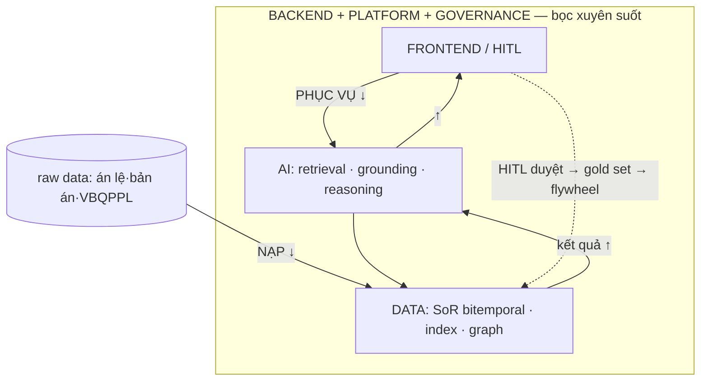
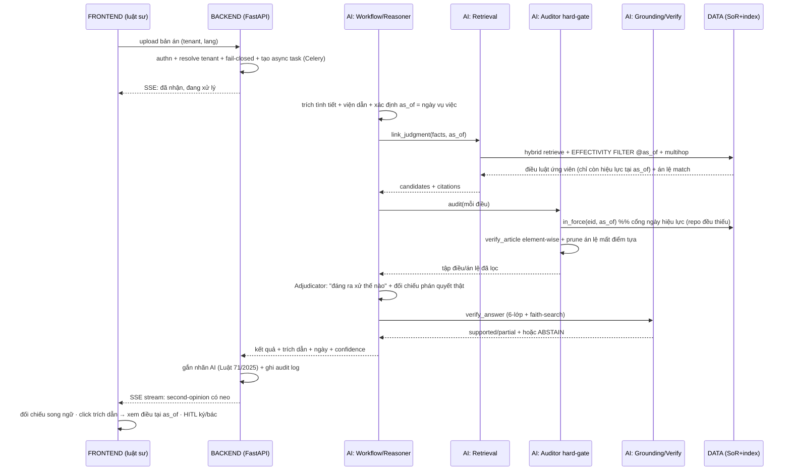

# TraLuat — Luồng kỹ thuật xuyên suốt (Data → AI → Backend → Frontend)

> Trả lời: **kỹ thuật xử lý thế nào từ data → AI → backend → frontend.**
> Hai trace: (A) "Đời của một văn bản" — luồng NẠP; (B) "Đời của một request" — luồng PHỤC VỤ.
> Giả định đã chốt: raw data có **đủ án lệ + toàn bộ bản án** (được phép dùng); đội tech mạnh & đông; pháp nhân OK.
> Đọc kèm `platform-architecture-audit.md`, `specs/w1..w6`.
> 🧠 **Tầng trí tuệ map lên 2 trace này (mỗi bước dùng RULE/ML/LLM nào + rule base map đâu):** xem **`specs/stack-db-and-models.md §5 Intelligence orchestration`** (A. Ingest pipeline ↔ Trace A; B. Query pipeline ↔ Trace B). Nguyên tắc: **RULE bọc 2 đầu, LLM ở giữa, không tin LLM thô.**

---

## ⚠️ Audit luồng: "data → AI → backend → frontend" đúng không?

**Trả lời thẳng: đúng như một trục, nhưng sai/thiếu như một luồng chạy. Phải tách hai thứ.**

### ✅ Đúng — khi hiểu là TRỤC TRƯỞNG THÀNH / PHỤ THUỘC (xây từ nền lên)
Thứ tự *đầu tư công sức & độ tin cậy*: phải có **data** đáng tin (bitemporal, hiệu lực) **trước** → rồi **AI** mới đáng tin (grounding dựa data đó) → rồi mới có cái đáng để **phục vụ** → **frontend** để con người dùng. Theo nghĩa này thứ tự của bạn **chuẩn**.

### ⚠️ Sai/thiếu — khi hiểu là LUỒNG CHẠY. Ba chỗ phải sửa:

1. **Backend KHÔNG nằm giữa AI và frontend — nó BỌC tất cả.** Backend là *vỏ*: host AI, kiểm soát truy cập data, thực thi tenant/residency/audit/nhãn AI. Vẽ nó thành một chặng tuyến tính là sai → nó là mặt phẳng xuyên suốt.
2. **Có HAI luồng NGƯỢC CHIỀU, không phải một:**
   - **NẠP (ingest):** nguồn → data → index — đi *về phía* data (Trace A).
   - **PHỤC VỤ (serve):** frontend → backend → AI → data → **quay ngược lên** (Trace B). Lúc phục vụ, thứ tự **đảo lại** đúng như bạn ngờ: *frontend trước, data sau cùng.*
3. **Governance + Human-in-the-loop KHÔNG phải điểm cuối — nó là VÒNG LẶP.** Luật sư ở frontend ký/bác → gold set → cải thiện AI/data (flywheel). Đường thẳng phải **cong lại thành vòng**.

### Mô hình đã sửa


- **Trục build:** Data → AI → Frontend (nền lên) — Backend/Platform/Governance là **vỏ song song**, dựng ngay từ đầu (không chờ sau AI).
- **Runtime:** NẠP (↓ về data) ⟂ PHỤC VỤ (FE↓ rồi ↑, tức *đảo* trục build) + **vòng HITL→flywheel**.
- **Thiếu trong luồng thẳng:** hai mặt phẳng xuyên suốt (Platform/Security + Governance) và vòng phản hồi — đã thêm ở trên.

> Tóm: giữ "data→AI→backend→frontend" làm **thứ tự XÂY**; nhưng khi nói **CHẠY**, nhớ: *nạp thì xuôi về data, phục vụ thì đảo ngược, và luôn khép thành vòng.*

---

## 0. Bốn chặng — ai chịu trách nhiệm gì

| Chặng | Chịu trách nhiệm | Output cho chặng sau |
|---|---|---|
| **DATA** (W1+W2) | nạp + cấu trúc hoá + bitemporal + đồ thị | SoR + chỉ mục truy vấn được (có `as_of`) |
| **AI** (W3+W4) | retrieval hiệu lforce + grounding + reasoning + Auditor | câu trả lời đã verify (hoặc abstain) + trích dẫn |
| **BACKEND** (W5) | API · async task · multi-tenant · residency · nhãn AI · audit | JSON có cấu trúc + stream sự kiện |
| **FRONTEND** (W6-L12) | UI rà soát · đối chiếu song ngữ · điều hướng trích dẫn · HITL | thao tác người dùng + chữ ký duyệt |

Bất biến chạy dọc cả 4 chặng: **mọi dữ liệu mang `as_of` (ngày hiệu lực) + `tenant` + trích dẫn**; qua AI phải verify hoặc abstain; qua Backend phải gắn nhãn AI + ghi audit; ở Frontend phải có HITL.

---

## A. TRACE A — Đời của một văn bản (luồng NẠP, batch)

Ví dụ: một **bản án** + nghị định nó viện dẫn, từ PDF → truy vấn được.

```mermaid
flowchart LR
  SRC[raw data: meta.json + PDF\n(án lệ · bản án · VBQPPL)] --> ACQ
  subgraph DATA
    ACQ[W1-1 Acquisition\nhash · provenance · kiểm ẩn danh NQ03/2017] --> OCR[W1-2 OCR/Parse\nđo tỉ lệ scan]
    OCR --> STR[W1-3 Cấu trúc hoá\nmeta.json→unit / Bluebell grammar]
    STR --> MET[W1-4 Metadata\nsố hiệu·ngày hiệu lực·cơ quan]
    MET --> REL[W1-5 Trích quan hệ ★\n'sửa đổi/bãi bỏ bởi' → norm_relation\n(traluat-cite kiểu eyecite)]
    REL --> VER[W2 Versioning bitemporal ★\napply_amendment → unit_version]
    VER --> ALN[W1-7 Song ngữ\nunit vi↔en → concept/term]
    ALN --> IDX[W1-8 Indexing\nchunk giữ-span → bge-m3]
  end
  VER --> PG[(Postgres SoR\nbitemporal)]
  IDX --> VEC[(pgvector)]
  REL --> GR[(norm graph:\nFK+CTE, AGE nếu cần)]
  ALN --> PG
  SRC --> OBJ[(Object store VN:\nPDF gốc)]
```

- Điều phối: **Temporal** (durable, resume, checkpoint HITL ở [5][6][7]).
- **Bản án** đặc biệt: W1 trích `cited_unit_eids` + `cited_precedent_ids` (viện dẫn điều luật/án lệ) → nạp cạnh vào đồ thị liên kết (W2 §5.2). Giữ `date` của bản án để sau lọc "luật tại thời điểm vụ việc".
- Kết quả: `document/unit/unit_version(bitemporal)/norm_relation/precedent/judgment` trong **Postgres SoR**; `chunk.embedding` trong **pgvector**; đồ thị trong **FK+CTE** (AGE khi cần). Blob gốc trong **object store tại VN**.
- Chỉ mục (vector/graph) **rebuild được** từ SoR (nguyên tắc mọi repo tán thành).

---

## B. TRACE B — Đời của một request: **Judgment Analysis**

"Đưa một bản án vào → đáng ra xử thế nào · đúng/sai · căn cứ điều luật · neo án lệ." Đây là trace khoe trọn data→AI→backend→frontend.



**Giải thích theo chặng:**

1. **FRONTEND → BACKEND:** luật sư upload bản án. Backend: authn, resolve `tenant_id` (fail-closed nếu thiếu), tạo Celery task, trả **SSE** để UI hiện tiến trình từng bước.
2. **AI — reasoning mở màn:** trích tình tiết + viện dẫn; đặt `as_of = ngày vụ việc` (KHÔNG phải hôm nay — mấu chốt).
3. **AI — retrieval:** `link_judgment` → hybrid (BM25+bge-m3) + **effectivity filter @as_of** (chỉ điều còn hiệu lực lúc đó) + multihop qua norm graph; match án lệ (curated-KB).
4. **AI — Auditor hard-gate:** mỗi điều qua cổng **có thật → `in_force(as_of)` → element-wise áp dụng**; **prune** án lệ mất điểm tựa. (Cổng `in_force` là thứ LegalGraphRAG/L-MARS đều thiếu — ta cắm vào.)
5. **AI — Adjudicator + Grounding:** tổng hợp "đáng ra xử thế nào" trên tập đã verify, đối chiếu phán quyết thật (doctrinal hook "áp dụng-hoặc-giải-thích" Điều 8 NQ 04/2019); `verify_answer` 6-lớp + faith-search → hoặc **abstain**.
6. **BACKEND trả về:** JSON có trích dẫn + ngày hiệu lforce + confidence; **gắn nhãn AI** + **ghi audit** (claim↔source↔date↔trace).
7. **FRONTEND:** render **second-opinion có neo** — đối chiếu song ngữ, click trích dẫn → `reconstruct_as_of` hiện đúng văn bản điều luật *tại ngày vụ việc*, màn hình **HITL** để luật sư ký duyệt / bác. Posture **rủi ro cao** (QĐ 33/2026): không bao giờ tự quyết, luôn người ký.

---

## C. Luồng rút gọn cho các tính năng khác (cùng xương)
- **Assistant:** B bỏ bước Auditor/Adjudicator → chỉ retrieve(@as_of) → generate → verify 3 cổng → trả lời/abstain.
- **Review:** upload hợp đồng (tenant-isolated) → phân loại điều khoản → *Pass A* rủi ro (retrieve+verify) + *Pass B* **omission** (đối `required_clause_rule`@T) → báo cáo có trích dẫn → HITL.
- **Compliance Diff:** chạy nghĩa vụ ở 2 `JurisdictionPack` (@as_of) → so khác biệt.

---

## D. Kỹ thuật tại mỗi ranh giới (contract + tech)

| Ranh giới | Tech | Hợp đồng truyền |
|---|---|---|
| Data → AI | Postgres SoR + pgvector + graph; interface `TemporalRepository/GraphQuery/LinkingService` | `in_force(as_of)`, `retrieve(as_of,tenant)`, `link_judgment` |
| AI nội bộ | LangGraph-style orchestration + LLM Gateway | candidates+citations → verified answer / abstain |
| AI → Backend | hàm service trả object | Answer{text, citations[+dates], confidence, ai_label} |
| Backend → Frontend | FastAPI REST + **SSE** stream | sự kiện step/tool + kết quả cuối + audit id |
| Frontend → Backend | REST (upload, ký HITL) | action + reviewer signature |

**Residency & cô lập chạy dọc:** mọi kho tại VN; KB luật shared read-only; dữ liệu khách cô lập (RLS+mã hoá), zero-retention tuỳ chọn; không train trên dữ liệu khách; nhãn AI ở gateway.

---

## E. Một hình để nhớ
**Data làm cho câu hỏi *trả lời được tại một ngày* → AI làm cho câu trả lời *đúng và có neo* → Backend làm cho nó *an toàn, cô lập, có vết* → Frontend làm cho luật sư *tin và ký được*.** Mỗi chặng thêm một tầng niềm tin; `as_of` + trích dẫn + tenant xuyên suốt cả bốn.
