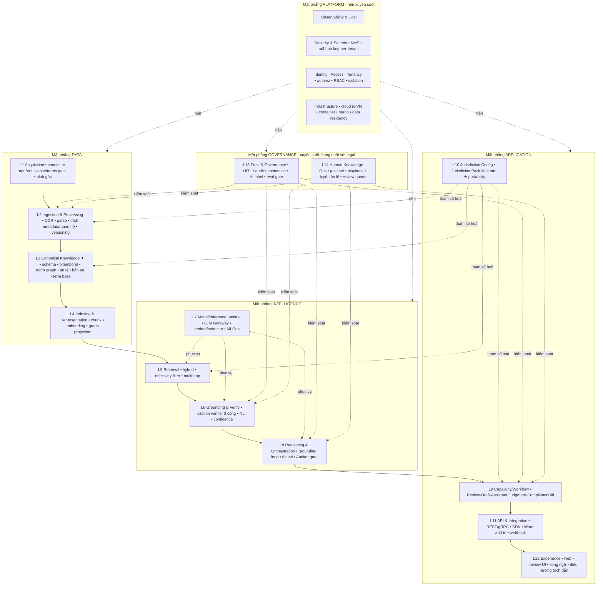

# TraLuat — Deep Audit: Stack layer đầy đủ

> Audit lại kiến trúc theo góc **layer**: một platform pháp lý với toàn bộ tính năng (Review, Draft, Assistant, **Judgment Analysis**, Compliance Diff, Reasoner đa vai, portable đa quốc gia) cần những layer gì, cụ thể ra sao.
> Đọc kèm `docs/architecture.md` (mô hình 4 tầng khái niệm) và `docs/technical-design.md`.

---

## 0. Kết luận audit (đọc trước)

**Mô hình "4 tầng" (Data · Grounding · Workflow · Trust) là bản đồ khái niệm, KHÔNG phải bản đồ thi công.** Nó **gộp hoặc giấu** ≥10 layer thực sự cần. Cụ thể 4 tầng bỏ sót:

| Layer bị 4-tầng giấu | Vì sao bắt buộc với tham vọng này |
|---|---|
| **Acquisition** (thu nạp nguồn) | Nguồn luật VN có rào license/terms, không API công khai (congbobanan), cần truy nguồn gốc & chống aggregator → là bề mặt rủi ro pháp lý riêng, không thể trộn vào ingestion |
| **Jurisdiction Config** (cấu hình pháp quyền) | "Thêm nước = cấu hình" bất khả thi nếu không có layer khai báo tham số hoá cả hệ → **đây là layer làm nên moat portability** |
| **Model/Inference runtime (MLOps)** | Fine-tune extractor, model registry, serving GPU, eval — "AI" trong 4 tầng bị xé lẻ, thiếu runtime quản mô hình |
| **Human Knowledge-Ops** (vận hành tri thức) | Chất lượng sản phẩm pháp lý đến từ gold set + playbook + án lệ do *chuyên gia tuyển* + HITL. Đây là layer (người + tool), không phải "bước duyệt" |
| **Security / Tenancy / Residency** | NĐ 356/2025 biến cô lập dữ liệu + hosting trong VN thành *yêu cầu pháp lý* → phải là layer kiến trúc, không phải cấu hình |
| **Observability / Eval-as-gate** | Benchmark 3 chiều là *cổng phát hành*, không phải báo cáo → phải là hạ tầng |
| **Experience** (trải nghiệp) | Cách luật sư *tiêu thụ* "việc đã xong" (điều hướng trích dẫn, song ngữ đối chiếu) là khác biệt sản phẩm |

→ Stack thật: **~15 layer, gom thành 5 mặt phẳng (plane).**

---

## 1. Bản đồ stack đầy đủ

---

## 2. Mặt phẳng PLATFORM (nền xuyên suốt)

### P1 — Infrastructure & Deployment
- **Trách nhiệm:** compute, mạng, lưu trữ, **ranh giới cư trú dữ liệu trong VN/khu vực**, tách plane batch vs online.
- **Thành phần/tech:** container (Docker) + orchestrator (K8s/Nomad); region VN; object storage (MinIO/S3); Postgres managed/self-host trong VN.
- **Vì sao bắt buộc:** data residency là ràng buộc *pháp lý* (NĐ 356/2025), không phải lựa chọn vận hành.

### P2 — Identity · Access · Tenancy
- **Trách nhiệm:** authn (SSO/OIDC), authz (RBAC: luật sư/duyệt/admin), định tuyến tenant, thực thi cô lập.
- **Tech:** Keycloak/Auth provider; RLS Postgres hoặc schema-per-tenant.
- **Bắt buộc:** đa tenant + cô lập dữ liệu khách là lõi mô hình kinh doanh + tuân thủ.

### P3 — Security & Secrets
- **Trách nhiệm:** mã hoá at-rest/in-transit, **key-per-tenant**, quản secret, zero-retention tuỳ chọn.
- **Tech:** KMS/Vault; TLS; column/field encryption cho dữ liệu khách.

### P4 — Observability & Cost
- **Trách nhiệm:** log/trace/metric mọi stage + mọi answer; theo dõi chi phí LLM/GPU.
- **Tech:** OpenTelemetry + Prometheus/Grafana + log store; dashboard chi phí token.
- **Bắt buộc:** không quan sát được = không kiểm toán được = không bán cho pháp chế được.

---

## 3. Mặt phẳng DATA

### L1 — Acquisition (thu nạp nguồn) ← *bị 4-tầng giấu*
- **Trách nhiệm:** connector tới nguồn hợp pháp (vbpl.vn, Công báo, anle/congbobanan **theo thỏa thuận**), **cổng license/terms**, ghi provenance + hash, lịch cập nhật, chống trùng, **tách/loại nguồn aggregator**.
- **Tech:** Temporal workers; blob store; registry nguồn + điều khoản.
- **Bắt buộc riêng:** nguồn luật VN không có API công khai, có rào pháp lý → đây là *bề mặt rủi ro* cần tách khỏi xử lý.

### L2 — Ingestion & Processing
- **Trách nhiệm:** 8 stage (OCR → cấu trúc hoá → trích metadata → **trích quan hệ sửa đổi/bãi bỏ** → **versioning**) — xem `technical-design.md §A.6`.
- **Tech:** Temporal; Tesseract-vie/VLM; parser grammar + LLM fallback; extractor fine-tune; HITL checkpoint ở [5][6][7].
- **Bắt buộc:** nơi "data thô → schema"; chứa bước moat #1.

### L3 — Canonical Knowledge (nguồn sự thật) ★ moat lõi
- **Trách nhiệm:** schema chuẩn trung lập pháp hệ; **bitemporal** (valid/transaction-time); đồ thị quan hệ quy phạm; án lệ; bản án; term base song ngữ; giải xung đột deterministic.
- **Tech:** Postgres (system-of-record) + bitemporal columns.
- **Bắt buộc:** đây là moat; mọi thứ trên tựa vào nó.

### L4 — Indexing & Representation (phái sinh)
- **Trách nhiệm:** chunk cấp điều–khoản (+ struct header); embedding; vector index; **graph projection** cho multi-hop; full-text index.
- **Tech:** pgvector (bge-m3) + Apache AGE/Neo4j + BM25.
- **Lưu ý:** là *chỉ mục phái sinh* của L3, không phải nguồn sự thật thứ hai → rebuild được từ L3.

---

## 4. Mặt phẳng INTELLIGENCE

### L5 — Retrieval
- **Trách nhiệm:** hybrid BM25+dense → RRF → rerank → **effectivity filter (`as_of_date`)** → multi-hop graph.
- **Tech:** bge-m3 + bge-reranker; AGE cho hop.
- **Điểm khác biệt:** effectivity filter — không có trong RAG thường.

### L6 — Grounding & Verification
- **Trách nhiệm:** **Citation Verifier 3 cổng** (có thật / còn hiệu lực / hỗ trợ khẳng định) + NLI + tổng hợp confidence + quyết định **abstain**.
- **Tech:** truy vấn bitemporal (cổng 1,2) + NLI fine-tune/LLM-judge (cổng 3).
- **Bắt buộc:** đây là "hợp đồng đầu ra" — thứ khiến output đáng tin cho pháp chế.

### L7 — Model/Inference runtime (MLOps) ← *bị 4-tầng giấu*
- **Trách nhiệm:** **LLM Gateway** (swappable model, prompt-cache, log I/O cho audit, nhãn AI, guard tenant); serving embedding/extractor (GPU pool); **model registry + versioning**; pipeline fine-tune; eval mô hình.
- **Tech:** gateway tự xây quanh Claude API (+ cửa self-host); vLLM/triton cho model nội; MLflow/registry.
- **Bắt buộc:** "AI" không chỉ là gọi API — cần runtime quản vòng đời mô hình, nếu không thì không fine-tune/không kiểm soát chi phí/không audit được.

### L8 — Reasoning & Orchestration
- **Trách nhiệm:** vòng lặp grounding (B.2); orchestration feature; **Reasoner đa vai** (Luật sư⇄Kiểm sát⇄Thẩm phán⇄Bộ ngành) với **Auditor hard-gate**.
- **Tech:** orchestrator trạng thái (LangGraph-style tự xây/Temporal); PAKTON (Apache-2.0) cho contract-QA; pattern viết lại từ LegalGraphRAG/AALawyer.
- **Bắt buộc:** nơi "tòa án trong máy" sống — nhưng chỉ bật sau khi L3–L6 qua benchmark.

---

## 5. Mặt phẳng APPLICATION

### L9 — Capability / Workflow
- **Trách nhiệm:** đóng gói feature thành service composable: Review, Draft, Assistant, **Judgment Analysis**, Compliance Diff (chi tiết build xem `technical-design.md §D`).
- **Bắt buộc:** đây là "việc đã xong" bán được.

### L10 — Jurisdiction Config (JurisdictionPack) ★ ← *bị 4-tầng giấu, nhưng là moat portability*
- **Trách nhiệm:** **cấu hình khai báo** tham số hoá cả hệ cho một pháp quyền: tháp thứ bậc văn bản + quy tắc thẩm quyền, ngữ pháp trích quan hệ, lịch hiệu lực/hồi tố, nguồn + quyền, term base, (nếu có) hệ án lệ.
- **Tech:** pack dạng khai báo (YAML/JSON + plugin ngữ pháp) nạp vào L2/L3/L5/L9.
- **Bắt buộc:** không có layer này thì VN bị hardcode → "thêm nước = viết lại", mất đúng khác biệt phòng thủ được.

### L11 — API & Integration
- **Trách nhiệm:** REST/gRPC đa tenant; SDK; **Word add-in** (nơi luật sư làm việc thật); webhook; connector ra (DMS/ký số).
- **Tech:** FastAPI; OpenAPI; add-in Office.

### L12 — Experience ← *bị 4-tầng giấu*
- **Trách nhiệm:** web app; **UI rà soát** (highlight rủi ro/bỏ sót theo màu); **đối chiếu song ngữ**; **điều hướng trích dẫn** (click điều khoản → xem văn bản tại ngày T); màn hình HITL.
- **Bắt buộc:** cách *tiêu thụ* "việc đã xong" là một nửa giá trị sản phẩm.

---

## 6. Mặt phẳng GOVERNANCE (xuyên suốt, hạng nhất với legal)

### L13 — Trust & Governance
- **Trách nhiệm:** HITL workflow + chữ ký duyệt; **audit trail** append-only (claim↔source↔date↔trace); policy confidence/abstention; **gắn nhãn AI** (Luật 71/2025); kiểm soát tuân thủ; **benchmark harness làm cổng CI**.
- **Bắt buộc:** với pháp lý, governance là tính năng, không phải phụ trợ.

### L14 — Human Knowledge-Ops ← *bị 4-tầng giấu, nhưng là flywheel chất lượng*
- **Trách nhiệm:** đội chuyên gia + công cụ: **gán gold set**, **tuyển & cập nhật án lệ**, **viết/bảo trì playbook & RequiredClauseRule**, duyệt hàng chờ HITL, phản hồi về fine-tune.
- **Tech:** annotation tool; review console; pipeline "output duyệt → gold set".
- **Bắt buộc:** chất lượng pháp lý không đến từ model — nó đến từ vòng *chuyên gia ↔ dữ liệu*. Đa số engineer bỏ quên layer này; với TraLuat nó là nguồn moat bền vững.

---

## 7. Feature nào "ép" layer nào (ma trận áp lực)

| Feature | Layer bị ép mạnh nhất |
|---|---|
| Assistant | L5 Retrieval · L6 Grounding |
| Review (+ bỏ sót) | L3 (RequiredClauseRule) · L6 · L14 (playbook) |
| Draft song ngữ | L3 (term base) · L9 · L12 |
| **Judgment Analysis** | L3 (án lệ+bản án+bitemporal) · L8 (reasoning) · L14 (tuyển án lệ) · L13 (định vị second-opinion) |
| Compliance Diff | **L10 Jurisdiction Config** · L3 (đa pháp quyền) |
| Reasoner đa vai | L8 · L6 (Auditor gate) · L7 (chi phí nhiều agent) |
| Portable sang nước 2 | **L10** · L1 · L2 (ngữ pháp mới) |

→ Đọc ngược: hai layer bị 4-tầng giấu mà **mọi tính năng khủng đều tựa vào** là **L10 (Jurisdiction Config)** và **L14 (Human Knowledge-Ops)**. Thiếu hai cái này, platform không portable và không giữ được chất lượng — dù L1–L9 hoàn hảo.

---

## 8. Thứ tự dựng layer (bám roadmap)

| Phase | Layer trọng tâm |
|---|---|
| 0 Nền hiệu lực | P1–P4, L1, L2, L3 (+ L14 tối thiểu để gán gold) |
| 1 MVP Review | L4, L5, L6, L7(gateway), L9(Review/Assistant), L13(benchmark-gate) |
| 2 Song ngữ+Trust | L3(term base), L12, L13 đầy đủ, P2/P3 cứng |
| 3 Judgment | L3(án lệ/bản án), L8, L14(tuyển án lệ) |
| 4 Reasoner đa vai | L8 đầy đủ, L7(serving nhiều agent) |
| 5 Diện rộng+Portable | **L10**, L1/L2 cho nước 2, L11(tích hợp) |

**Bất biến layer:** L3 là nguồn sự thật duy nhất; L4 luôn rebuild được từ L3; mọi đường ra người dùng (L9→L11→L12) phải đi qua L6 (verify) và chịu L13 (governance). Không có đường tắt bỏ qua L6/L13.
