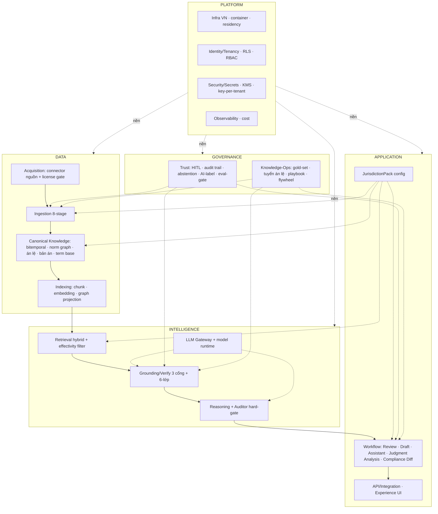
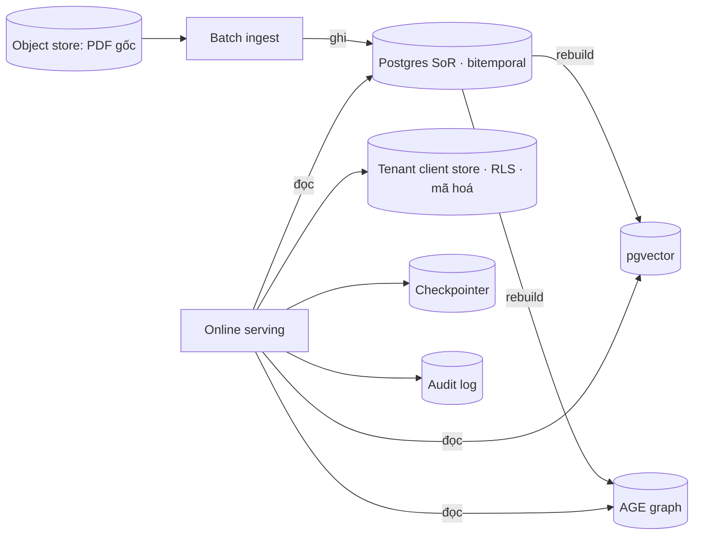

# TraLuat — Deep audit kiến trúc platform

> Audit tổng hợp: platform **có những gì · phục vụ tính năng gì · data platform xử lý thế nào · phân luồng lưu trữ thế nào**, và **đối chiếu repo** xem khớp không.
> Giả định đã chốt: **đội tech mạnh & đông** (không giới hạn scale/song song); **pháp nhân được chính phủ cho phép** (gỡ ràng buộc NĐ 356 Đ21-22 về pháp nhân VN + chứng nhận — vẫn giữ nghĩa vụ kỹ thuật: residency, isolation, labeling).
> Đọc kèm: `implementation-architecture.md`, `layered-architecture.md`, `technical-design.md`, `specs/w1..w6`.

---

## 1. Platform CÓ NHỮNG GÌ (component inventory — 5 mặt phẳng)



15 layer, gom 5 mặt phẳng. Chi tiết từng layer: `layered-architecture.md`.

---

## 2. PHỤC VỤ TÍNH NĂNG GÌ (feature → component)

| Tính năng | Vào → Ra | Component "ép" mạnh nhất |
|---|---|---|
| **Assistant** | hỏi → đáp có trích dẫn, song ngữ, ngày hiệu lực | I4 Retrieval · I3 Grounding |
| **Review** | hợp đồng → rủi ro + **bỏ sót** + checklist | D2 (`required_clause_rule`@T) · I3 · G2 playbook |
| **Draft** | yêu cầu → hợp đồng song ngữ có trích dẫn | D2 term base · A1 · A3 |
| **Judgment Analysis** | bản án → đúng/sai + căn cứ + án lệ | D2 (án lệ+bản án+bitemporal) · I1 Auditor · G2 · G1 (rủi ro cao) |
| **Compliance Diff** | tình huống xuyên biên → khác biệt nghĩa vụ | A2 JurisdictionPack · D2 đa pháp quyền |
| **Reasoner đa vai** | tranh biện 4 vai | I1 + I3 (Auditor mọi phát ngôn) · I2 (chi phí nhiều agent) |

**Bất biến mọi tính năng:** output = trích dẫn điều–khoản + ngày hiệu lforce + confidence + song ngữ + nhãn AI + HITL; đi qua I3 (verify) và chịu G1 (governance) — **không đường tắt**.

---

## 3. DATA PLATFORM XỬ LÝ THẾ NÀO

Hai mặt phẳng tách biệt (scale độc lập — đội mạnh nên chạy song song thoải mái):

### 3.1 Batch — nạp & xử lý (offline)
```
Nguồn hợp pháp (vbpl.vn miễn phí NĐ52/2015 · Công báo · anle/congbobanan)
  → [1] Acquisition: connector + hash + provenance + license gate (+ fix TLS anle.toaan.gov.vn)
  → [2] OCR/Parse: scan→OCR vie (đo tỉ lệ scan!) · text-PDF/DOCX/HTML→text
  → [3] Cấu trúc hoá: meta.json→unit (nếu đã cấp điều/khoản) hoặc parse grammar (Bluebell-style)
  → [4] Metadata: số hiệu · ngày ban hành · NGÀY HIỆU LỰC · cơ quan
  → [5] Trích quan hệ ★: "được sửa đổi/bãi bỏ bởi" → norm_relation (engine traluat-cite kiểu eyecite)
  → [6] Versioning bitemporal ★: áp norm_relation → materialize unit_version
  → [7] Căn chỉnh song ngữ: unit vi↔en → concept/term
  → [8] Indexing: chunk giữ-span → embed (bge-m3) → vector + graph projection
  (HITL checkpoint ở [5][6][7]; output duyệt → gold set → flywheel)
```
Điều phối: **Temporal** (durable, retriable, resume, checkpoint HITL tự nhiên).

### 3.2 Online — phục vụ (realtime)
```
Request → API (authn, resolve tenant+lang+as_of) → Workflow
  → Retrieval (hybrid + rerank + EFFECTIVITY FILTER @as_of + multihop)
  → LLM Gateway (generate, inline citations, prompt-cache)
  → Grounding/Verify (3 cổng: có thật/còn hiệu lực/hỗ trợ + 6-lớp + faith-search)
  → confidence/abstain → Answer (+ audit log + AI label)
```

**Đặc tính xử lý:** nguồn-sự-thật ghi ở batch; online **chỉ đọc** KB luật; dữ liệu khách (hợp đồng upload) xử lý trong vùng cô lập tenant, **không** trộn vào KB, **không** train.

---

## 4. PHÂN LUỒNG LƯU TRỮ (storage partitioning & routing)

### 4.1 Ba trục phân luồng
1. **Theo vai trò dữ liệu:** nguồn-sự-thật ⟂ chỉ mục phái sinh ⟂ blob gốc ⟂ cache ⟂ lịch sử hội thoại.
2. **Theo tenant:** KB luật **chia sẻ, read-only** ⟂ dữ liệu khách **cô lập cứng** (RLS/schema-per-tenant + mã hoá key-per-tenant).
3. **Theo thời gian:** bên trong nguồn-sự-thật, mọi `unit_version` mang bitemporal (valid-time + transaction-time).

### 4.2 Các kho & định tuyến (cái gì ở đâu, vì sao)

| Kho | Chứa gì | Vai trò | Tenant |
|---|---|---|---|
| **Postgres (SoR)** | `document/unit/unit_version(bitemporal)/norm_relation/precedent/judgment/concept/term/required_clause_rule` | **Nguồn-sự-thật duy nhất** | KB luật: shared |
| **pgvector** | `chunk.embedding` (bge-m3) | Chỉ mục retrieval — **phái sinh, rebuild được** | shared (KB) + namespace tenant (dữ liệu khách) |
| **Apache AGE** (graph/Postgres) | norm graph + linking graph projection | Chỉ mục multi-hop — **phái sinh** | shared |
| **Object store (MinIO/S3, VN)** | PDF/scan gốc + hash | Lưu bản gốc, truy nguồn | shared (nguồn công) + vùng tenant (upload khách) |
| **Checkpointer (Postgres)** | lịch sử hội thoại/agent | Trạng thái phiên | per-tenant |
| **Cache (diskcache/Redis)** | embed/rerank/LLM theo content-hash | Tất định + rẻ + hợp CI | shared (khử tenant-PII) |
| **Tenant client store** | hợp đồng khách + `review_result` | Dữ liệu khách | **cô lập cứng + mã hoá** |
| **Audit log (append-only)** | claim↔source↔date↔trace | Governance/phòng vệ | per-tenant |

### 4.3 Quy tắc định tuyến (routing rules)
- **Ghi:** chỉ batch ghi vào SoR. Online **không** ghi SoR.
- **Phái sinh:** pgvector + AGE **luôn rebuild được** từ SoR → không phải nguồn-sự-thật thứ hai; mất là dựng lại.
- **Residency:** **mọi kho đặt tại VN/khu vực** (Luật 91/2025 + NĐ 356/2025). Dữ liệu khách có cờ **zero-retention** (checkpointer no-persist mode).
- **Cô lập:** KB luật không gắn tenant (shared read-only); dữ liệu khách gắn `tenant_id` mọi nơi, **fail-closed** nếu thiếu tenant context; **không** dùng dữ liệu khách train.
- **Nhãn AI:** gắn ở API/Gateway trước khi rời hệ (Luật 71/2025).



---

## 5. DEEP-CHECK REPO MATCH — lưu trữ & xử lý (ĐÃ VERIFY, file+line)

Cách từng repo **thực sự** lưu trữ (`research_notes/Repo deep read/storage_dataflow_check.md`):

| Repo | Lưu trữ thật | pgvector? | Graph DB? | Bitemporal? | Multi-tenant? |
|---|---|---|---|---|---|
| **PAKTON** | Postgres (metadata mỏng) + AsyncPostgresSaver + **Pinecone/Chroma** + LightRAG HTTP (optional) | ❌ | ❌ | ❌ | ❌ (chỉ user_email) |
| **Indigo** | Postgres: **AKN XML nguyên khối 1 cột** `document_xml`; Work/Amendment = bảng + FK; traverse bằng Python/join | ❌ | ❌ (FK quan hệ) | ❌ (valid-time 1 trục) | ❌ |
| **legalbenchrag** | **sqlite-vec** (xoá+dựng mỗi lần) + diskcache md5; chunk metadata in-memory | ❌ | — | — | — |
| **LeSICiN** | **file JSON edge → torch_sparse in-memory**; cache pickle | — | ❌ (file) | ❌ | — |
| **LegalGraphRAG** | **NetworkX in-memory** → 1 file pickle; vector = numpy dict brute-force | ❌ | ❌ (NetworkX) | ❌ | — |
| **L-MARS** | **stateless**; BM25 in-memory tạm từ JSON; search tool ngoài | — | — | — | — |

### Kết luận match (quan trọng)
- ✅ **"Chỉ mục phái sinh rebuild được"** — **MỌI repo tán thành mạnh** (sqlite-vec xoá mỗi lần, graph dựng lại từ JSON/pickle). Đây là lựa chọn được chứng minh nhất của ta.
- ✅ **3-store split** khớp PAKTON; **chunk giữ-span** khớp legalbenchrag; **Postgres-as-SoR** chỉ Indigo xác thực (và mạnh).
- ⚠️ **Ba cược của TraLuat KHÔNG repo nào validate** (net-new, rủi ro thật — đội mạnh gánh được nhưng phải biết):
  1. **Apache AGE (graph-on-Postgres)** — *rủi ro nhất*. Không repo nào dùng graph-DB; Indigo mã hoá đồ thị quy phạm/sửa đổi bằng **FK quan hệ** và *chưa từng cần* graph engine. → **Khuyến nghị tinh chỉnh:** khởi đầu norm graph bằng **FK + recursive CTE trên Postgres**; chỉ thêm **AGE/Neo4j khi thật sự cần multi-hop openCypher** (dẫn chiếu sâu). Đừng cam kết AGE sớm.
  2. **Bitemporal `unit_version`** — không repo nào có; Indigo (chín nhất) chỉ 1 trục. Cược mới + phức tạp thật → đầu tư test kỹ (acceptance W2).
  3. **Multi-tenant isolation** — không repo nào làm (PAKTON chỉ scope theo user_email). Thiết kế from first principles (W5).
- **pgvector / object storage**: không repo dùng pgvector (họ dùng vector-DB riêng vì là prototype), nhưng đây là **quyết định hợp nhất hợp lý, rủi ro thấp** — chỉ *chưa* được validate ở quy mô lớn bởi nhóm repo này.

> Diễn giải: ~70% hạ tầng khớp repo đã verify; **ba cược lõi (AGE, bitemporal, tenant) đúng là phần moat/net-new** — nhất quán với mọi đợt deep-check. Điều chỉnh hành động duy nhất: **hoãn AGE, bắt đầu bằng FK + recursive CTE.**

---

## 6. CÁI GÌ TRALUAT-SPECIFIC (không repo nào có)
1. **Bitemporal SoR** (valid + transaction time) — Indigo chỉ valid-time; còn lại không có.
2. **Effectivity filter** trong retrieval + **cổng ngày hiệu lực** trong Auditor/Verifier — mọi repo trống.
3. **Tenant isolation + residency VN** — PAKTON một index chung.
4. **Omission vs luật bắt buộc @T** — vendor chỉ playbook tĩnh.
5. **Song ngữ căn chỉnh khái niệm VN-EN** — không corpus mở.
6. **Judgment Analysis neo án lệ** (rủi ro cao, HITL) — greenfield.

→ **Kết:** ~70% hạ tầng (backend skeleton, retriever interface, chunker, auditor pattern, data-model pattern) **tái dùng được từ repo đã verify**; ~30% là moat tự xây, và **100% phần moat đều rơi đúng vào chỗ mọi repo để trống** — nhất quán qua mọi đợt deep-check.

---

## 7. BỔ SUNG cần thêm để khớp tính năng sản phẩm

Audit "feature đòi hỏi gì → ta có chưa" (xuất phát từ sơ đồ đã sửa ở `end-to-end-flow.md`: vòng lặp + luồng nạp phải chạm tới tenant). Tất cả **cắm thêm vào khung 15-layer, không đập đi**.

| Bổ sung | Vì tính năng | Layer cắm vào | Mức |
|---|---|---|---|
| **Change-Propagation + Watcher + Notification** ★ | khi nạp sửa đổi/bãi bỏ → cảnh báo tenant "luật hợp đồng bạn dựa vào vừa đổi" | mới, nối L2↔L3↔tenant | **🥇 differentiator** |
| **Client Document Service** | Review/Draft: vòng đời tài liệu khách (phiên bản · redline · track-change · DOCX in/out) | mới, cạnh L9, tách KB luật | 🥈 table-stakes |
| **Feedback/Labeling/Dataset service** | khép vòng HITL→gold-set→retrain (dataset có version) | nâng L14 thành runtime | 🥉 |
| **Quality telemetry (production)** | theo dõi abstain-rate · faithfulness · drift theo tenant | nâng L13/P4 runtime | 🥉 |
| **Explanation/provenance read-model** | UI điều hướng: chuỗi lập luận + đường trích dẫn + dựng điều @as_of | đọc từ audit L13, phục vụ L12 | 🥉 |
| **Jurisdiction router (serve-time)** | Compliance Diff chạy 2 pack · portability | runtime cho L10 | nền |
| **Usage metering/billing** | SaaS thương mại: đo dùng + tính tiền theo tenant | mới, P-plane | nền |

**🥇 Nổi bật — Change-Propagation/Watcher:** biến **đồ thị hiệu lực (moat #1)** từ *chi phí nền* thành *tính năng bán được chủ động* ("luật bạn dựa vào vừa đổi"). Chỉ khả thi vì có đồ thị hiệu lực + liên kết bản-án/hợp-đồng↔điều-luật. Tương đương managed-agent của Claude for Legal (reg-monitor/renewal-watcher/docket-watcher) nhưng **có neo hiệu lực** — đối thủ không làm được. Là lý do thứ 2 (sau Judgment Analysis) để sở hữu moat #1.

**Cơ chế Change-Propagation (phác):** luồng nạp tạo/sửa `norm_relation` → emit event `UnitChanged(unit_eid, effective_date)` → tra ngược các `judgment`/`contract`/`review_result` có `cited_unit_eids` chứa unit đó (hoặc phụ thuộc qua graph) → xếp hàng Notification cho tenant liên quan (tôn trọng cô lập). Đây là mũi tên "luồng nạp → tenant" mà sơ đồ thẳng ban đầu thiếu.
