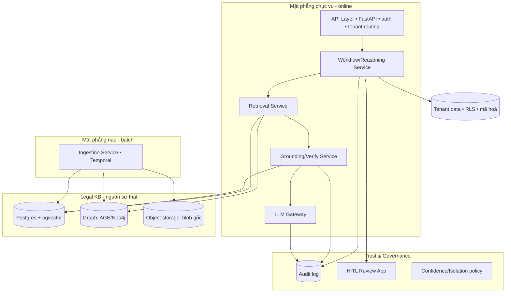

# TraLuat — Thiết kế kỹ thuật (Data · AI · Layer · Feature)

> Bản thiết kế cấp kỹ sư. Đọc kèm `docs/architecture.md` (tổng quan chiến lược) và `docs/roadmap.md`.
> Mọi lựa chọn công nghệ dưới đây là **khuyến nghị có lý do**; chỗ nào đảo ngược được rẻ thì ghi rõ.
> Số hiệu văn bản pháp luật trong ví dụ là minh hoạ — đối chiếu văn bản gốc khi hiện thực.

---

## A. DATA — mô hình dữ liệu & pipeline

### A.1 Hệ định danh (canonical ID / URN)

Định danh trung lập pháp hệ, phỏng theo ELI + FRBR. Ba cấp:

```
Work (văn bản):           trl:vn/nd/31-2021-nd-cp
Structural unit:          trl:vn/nd/31-2021-nd-cp/dieu-3/khoan-2/diem-a
Temporal+Lang version:    trl:vn/nd/31-2021-nd-cp/dieu-3/khoan-2@2024-07-01/vi
```

- `@YYYY-MM-DD` = point-in-time (valid-time). `/vi|/en` = language version.
- ID là **khóa tự nhiên** để join statute ↔ precedent ↔ judgment. Mọi trích dẫn trong hệ thống dùng ID này.

### A.2 Schema cốt lõi (Postgres, system-of-record)

Quan hệ chính (rút gọn, kiểu minh hoạ):

```sql
jurisdiction(id, code, name, legal_family, config_ref)

authority(id, jurisdiction_id, name, type, rank_level INT, parent_id)
  -- rank_level: QH=100, UBTVQH=90, CP=80, TTg=70, Bộ=60, Tỉnh=40... → lex superior

document(id, jurisdiction_id, doc_number, doc_type, authority_id,
         title_vi, title_en, date_issued, date_effective, date_expired,
         status, source_uri, source_hash, gazette_ref)

unit(id, document_id, parent_id, unit_type, ordinal, label, path)
  -- unit_type ∈ {phan,chuong,muc,dieu,khoan,diem}; cây đệ quy

-- ★ TRÁI TIM: phiên bản văn bản theo thời gian (BITEMPORAL)
unit_version(id, unit_id, lang,
             valid_from, valid_to,      -- hiệu lực thực tế (valid-time)
             tx_from, tx_to,            -- hệ thống ghi nhận (transaction-time)
             text, normative_rule_ref,  -- link LegalRuleML nếu là quy phạm deontic
             source_relation_id,        -- sửa đổi nào tạo ra version này
             review_status, created_by)

-- ★ Đồ thị quan hệ quy phạm
norm_relation(id, src_unit_id, dst_unit_id, relation_type,
              effective_date, evidence_span, confidence, review_status)
  -- relation_type ∈ {cites, amends, repeals, replaces, guides, conflicts, hierarchy}

precedent(id, jurisdiction_id, number, name, source_judgment_id,
          situation, solution, interpreted_unit_ids[],
          date_adopted, date_effective, date_annulled, annul_cause)

judgment(id, jurisdiction_id, court_id, case_no, date, matter_type,
         facts, holdings, cited_unit_ids[], cited_precedent_ids[],
         outcome_label, anonymization_status, source_uri)

-- Song ngữ (moat 3)
concept(id, label)
term(id, concept_id, lang, text, authority_source)
concept_alignment(concept_id, equivalence_type, note)
  -- equivalence_type ∈ {full, partial, none}

-- Bỏ sót (moat 2)
clause_type(id, name, cuad_mapping)
required_clause_rule(id, jurisdiction_id, contract_type, clause_type_id,
                     valid_from, valid_to, source_unit_id, severity)

-- Phái sinh cho retrieval
chunk(id, unit_version_id, lang, text, embedding VECTOR, struct_header)
```

**Dữ liệu khách (tách hoàn toàn khỏi KB luật):**
```
tenant(id, name, region, isolation_mode)
contract(id, tenant_id, title, lang, storage_ref, encryption_key_ref)   -- RLS theo tenant
review_result(id, contract_id, findings_json, confidence, reviewer_sig, created_at)
```

### A.3 Bitemporal: vì sao hai trục & cách tái dựng "văn bản tại ngày T"

- **valid-time** = khoảng điều khoản có hiệu lực pháp lý. **transaction-time** = khoảng hệ thống *tin là* như vậy. Hai trục giải hai bài một-trục không giải được: (a) **sửa đổi hồi tố** (luật đổi hiệu lực cho quá khứ), (b) **ta sửa dữ liệu sai** mà vẫn tra được "trước đây hệ thống từng nói gì" (audit/phòng vệ pháp lý).

- **Tái dựng văn bản của một `unit` tại ngày T (as-of):**
  ```
  SELECT text FROM unit_version
  WHERE unit_id = :u AND lang = :L
    AND valid_from <= :T AND (valid_to IS NULL OR :T < valid_to)
    AND tx_to IS NULL          -- phiên bản ta tin là đúng hiện giờ
  ```
  Duyệt cây `unit` theo `path`, ghép các `unit_version` as-of → ra **bản hợp nhất tại ngày T**. Điều đã bị bãi bỏ tại T → không có version thoả → *vắng mặt đúng* (không trả ra).

- **Khi áp một sửa đổi (bước pipeline [6]):** đóng version cũ (`valid_to = ngày hiệu lực sửa đổi`), tạo version mới (`valid_from = ngày đó`, `source_relation_id` trỏ `norm_relation`). Bãi bỏ = tạo "tombstone" version (text NULL/đánh dấu repealed).

### A.4 Giải xung đột quy phạm (deterministic, không để LLM đoán)

Khi nhiều đơn vị cùng điều chỉnh một vấn đề: hàm thuần trên đồ thị + `authority.rank_level`:
1. **lex superior** — rank cao thắng (Luật > Nghị định > Thông tư).
2. **lex posterior** — cùng cấp, văn bản/hiệu lực mới hơn thắng.
3. **lex specialis** — chuyên ngành thắng chung (đánh dấu bằng metadata phạm vi).
Kết quả kèm *giải thích* (vì sao chọn) → vào audit trail. Đây là logic, không phải prompt.

### A.5 Lựa chọn lưu trữ (khuyến nghị)

**Khuyến nghị: Postgres là một nguồn sự thật duy nhất**, với:
- cột bitemporal tường minh (`valid_from/valid_to/tx_from/tx_to`) + lớp truy vấn temporal mỏng ở application (dễ vận hành, một hệ, dễ tuyển người);
- **pgvector** cho embedding (khỏi thêm vector DB riêng ở giai đoạn đầu);
- **Apache AGE** (openCypher trên Postgres) cho multi-hop norm graph — hoặc tách **Neo4j** nếu truy vấn đồ thị nặng.

*Vì sao không XTDB ngay:* XTDB cho bitemporality "miễn phí" nhưng thêm một runtime JVM + ít người biết. Giữ **XTDB như phương án B** nếu logic bitemporal ở application phình to. Quyết định này **đảo ngược được** vì đã cô lập sau `TemporalRepository` interface.

- **Blob gốc** (PDF/scan) → object storage (MinIO/S3), lưu `source_hash` để truy nguồn + chống trùng.

### A.6 Pipeline nạp — stage cụ thể + công nghệ + data contract

Điều phối bằng **Temporal** (durable workflow: retriable, resume được, checkpoint HITL tự nhiên). Mỗi stage nhận/phát **JSON có version schema**, idempotent, ghi provenance.

| # | Stage | Công nghệ khuyến nghị | Output contract |
|---|---|---|---|
| 1 | Ingest & dedup | Temporal + object storage; hash SHA-256 | `RawDoc{blob_ref, hash, mime, source_uri}` |
| 2 | OCR / Parse | scan→OCR tiếng Việt (Tesseract `vie` hoặc VLM cho bảng/scan xấu); text-PDF→PyMuPDF; DOCX→python-docx; HTML→selectolax | `PlainDoc{text, layout_spans, ocr_conf}` |
| 3 | Cấu trúc hoá | Parser luật VN (grammar regex Điều/Khoản/Điểm) + **LLM fallback** cho văn bản lộn xộn → cây Akoma Ntoso | `StructuredDoc{unit_tree}` |
| 4 | Trích metadata | regex (số hiệu/ngày) + **token-classifier fine-tune** (ViLegalBERT) cho cơ quan/căn cứ; validate theo controlled vocab | `DocMeta{doc_number,date_effective,authority,...}` |
| 5 | **Trích quan hệ** ★ | bootstrapping mẫu câu + **extractor fine-tune** + LLM constrained-output; độ tin thấp → HITL | `Relations[]{src,dst,type,effective_date,span,conf}` |
| 6 | **Versioning/hợp nhất** ★ | logic bitemporal thuần (áp Relations lên unit_version) | `UnitVersions[]` ghi vào KB |
| 7 | Căn chỉnh song ngữ ★ | align câu VN↔EN (bản dịch chính thức) + khai thác thuật ngữ → `concept/term` | `Alignments[]`, `Concepts[]` |
| 8 | Indexing | chunk theo unit + struct_header; embed **bge-m3**; upsert pgvector + graph | `Chunks[]` |

- **HITL checkpoint** đặt ở [5][6][7] — nơi sai sót thành sai luật. Output duyệt → **quay lại làm gold set** (flywheel huấn luyện).
- **[2] là chi phí ẩn lớn nhất** nếu corpus nhiều scan → đo tỉ lệ scan sớm (xem audit 4TB).

---

## B. AI — stack mô hình & vòng lặp grounding

### B.1 Nguyên tắc: không phải cái gì cũng LLM

Phân việc đúng loại mô hình — để **xác định được, kiểm toán được, rẻ, chạy được trên hàng triệu đơn vị**:

| Tác vụ | Cách làm | Lớp mô hình |
|---|---|---|
| OCR | OCR engine / VLM | Tesseract-vie / VLM |
| Cấu trúc hoá | Rule + LLM fallback | regex grammar + small LLM |
| Trích metadata | Regex + NER | token-classifier (PhoBERT/ViLegalBERT) |
| **Trích quan hệ sửa đổi/bãi bỏ** | Extractor fine-tune + LLM constrained + HITL | ViLegalBERT/Qwen + Claude |
| Embedding / retrieval | Dense + sparse | **bge-m3 (MIT)** + BM25 |
| Rerank | Cross-encoder | bge-reranker / fine-tune |
| Citation verify — có thật | Tra KB | deterministic |
| Citation verify — còn hiệu lực | Truy vấn bitemporal | deterministic |
| Citation verify — hỗ trợ khẳng định | NLI/entailment | NLI fine-tune (ViNLI/XNLI) + LLM-judge |
| Omission detection | Retrieval + rule + LLM | Claude + RequiredClauseRule |
| Review/Draft narrative | LLM grounded | **Claude** (Opus: khó; Sonnet: khối lượng lớn) |
| Judgment analysis | Retrieval + reasoning + precedent match | Claude + module CBR |
| Reasoner đa vai | LLM agents + Auditor gate | Claude orchestration |

> Quy tắc: **mô hình nhỏ fine-tune + rule** cho trích xuất/phân loại chạy hàng loạt; **LLM** cho tổng hợp/suy luận ngôn ngữ, **luôn bị neo** vào văn bản truy xuất, không tin kiến thức tham số của model.

### B.2 Vòng lặp grounding — bất biến của MỌI câu trả lời

```python
def answer(query, tenant):
    q = parse(query)                      # intent, as_of_date (mặc định: hôm nay), jurisdiction, lang
    cands = hybrid_retrieve(q)            # BM25 + dense(bge-m3) → RRF
    cands = rerank(q, cands)              # cross-encoder
    cands = effectivity_filter(cands, q.as_of_date)   # ★ chỉ giữ đơn vị còn hiệu lực tại T
    cands = graph_expand(cands, hops=q.need_multihop) # dẫn chiếu / văn bản hướng dẫn
    draft = llm_generate(q, cands,                      # LLM chỉ được dùng cands
                         require_inline_citations=True)
    for c in draft.citations:             # ★ Citation Verifier — 3 cổng
        assert c.unit_id in KB                          # (1) có thật
        assert in_force(c.unit_id, q.as_of_date)        # (2) còn hiệu lực
        c.support = nli_supports(draft.claim(c), KB.text(c.unit_id))  # (3) hỗ trợ
    conf = aggregate_confidence(draft, failures)
    if conf < THRESHOLD: return ABSTAIN(reason, partial_cites)
    return Answer(text, citations_with_dates, conf, ai_label=True, bilingual=...)
```

- **effectivity_filter** và cổng (2) là thứ tách TraLuat khỏi RAG thường.
- Cổng (3) khớp-hỗ-trợ ở mức statute VN **không có công cụ mở** → tự xây (eyecite là US-only). Bắt đầu bằng NLI fine-tune + LLM-judge, tiến tới khớp span nguyên văn.
- Trượt cổng → hạ confidence hoặc **abstain**. Abstain là tính năng, không phải lỗi.

### B.3 LLM Gateway (trừu tượng hoá, bắt buộc)

Mọi lời gọi LLM đi qua `LLMGateway` — không gọi thẳng API rải rác:
- **Swappable model** (Claude Opus/Sonnet qua API; chừa cửa self-host cho tenant nhạy cảm theo NĐ 356/2025).
- **Prompt caching** cho ngữ cảnh grounding/hệ thống lớn (giảm chi phí mạnh).
- **Logging I/O** đầy đủ cho audit trail + **gắn nhãn AI** (Luật 71/2025) ở đầu ra.
- **PII/tenant guard**: chặn rò dữ liệu khách sang prompt sai tenant.

### B.4 Fine-tune & eval (flywheel)

- Fine-tune extractor (relation, metadata, NLI) **trên dữ liệu nguồn gốc tự nạp + gold set do luật sư gán** — **không** train trên dữ liệu NC (VLQA) hay aggregator.
- **Output HITL duyệt → gold set** → vòng cải thiện khép kín.
- **Eval harness = cổng CI**: benchmark 3 chiều (đúng điều–khoản / đúng hiệu lực / bắt bỏ sót) + metric theo tác vụ (retrieval P@k/R@k, citation-faithfulness, omission recall, effectivity accuracy). Không qua cổng → không phát hành.
- ⚠️ Judgment Analysis: thiết kế chống **shortcut-learning** — bắt buộc neo điều luật + án lệ, không để model đoán kết quả theo đặc trưng bề mặt.

---

## C. LAYER — kiến trúc phần mềm & thành phần

### C.1 Thành phần (service/module)



- **Ingestion Service** (batch, Temporal) ghi vào Legal KB.
- **Legal KB** = Postgres(+pgvector) + graph projection + object storage. **Chia sẻ, read-only** khi phục vụ.
- **Retrieval / Grounding / LLM Gateway / Workflow** = mặt phẳng online.
- **Trust**: audit log (append-only), HITL app, policy confidence + cô lập tenant.
- **Tenant data** (hợp đồng khách) **tách hẳn**: RLS theo `tenant_id` hoặc schema-per-tenant; mã hoá theo tenant; **không bao giờ** dùng train, không qua tenant khác.

### C.2 Multi-tenancy & data residency (ánh xạ tuân thủ)

- **KB luật**: dữ liệu công, chia sẻ, không gắn tenant.
- **Dữ liệu khách**: cô lập cứng (RLS + mã hoá + zero-retention tuỳ chọn) — yêu cầu của NĐ 356/2025.
- **Hosting trong VN/khu vực**; ranh giới cư trú dữ liệu là ràng buộc triển khai, không phải tuỳ chọn.
- **Nhãn AI** ở mọi output máy sinh (Luật 71/2025) — gắn tại LLM Gateway + API layer.

### C.3 Luồng một request (Assistant, ví dụ)

```
Client → API (authn, resolve tenant+lang) → Workflow(Assistant)
 → Retrieval (hybrid+rerank+effectivity@as_of_date)
 → [Graph expand nếu đa bước]
 → LLM Gateway (generate, inline citations, prompt-cache)
 → Grounding/Verify (3 cổng + NLI support)
 → Confidence policy → (Answer | Abstain)
 → Audit log (claim↔source↔date↔trace) + AI label
 → Client
```

### C.4 Triển khai

- Containerized; tách **batch (ingestion)** và **online (serving)** để scale độc lập.
- Online: stateless services sau load balancer; Postgres primary + read-replica cho retrieval.
- Batch: Temporal workers; GPU pool cho OCR/embedding/extractor.
- Observability: trace mỗi stage + mỗi answer; metric benchmark làm cổng CI.

---

## D. FEATURE — cách dựng từng tính năng (trên cùng nền A/B/C)

Mọi feature tái dùng: Retrieval + Grounding + LLM Gateway + Trust. Khác nhau ở **orchestration** trong Workflow Service.

### D.1 Assistant (hỏi–đáp có trích dẫn, song ngữ)
Vào: câu hỏi (+ `as_of_date`, lang). Pipeline: đúng vòng lặp B.2. Ra: trả lời + trích dẫn điều–khoản + ngày hiệu lực + confidence, song ngữ. Abstain khi không neo được.

### D.2 Review (rà hợp đồng → rủi ro + bỏ sót + checklist)
Vào: hợp đồng khách (tenant-isolated) + loại hợp đồng + jurisdiction + ngày. Pipeline:
1. Phân đoạn hợp đồng → điều khoản; phân loại theo `clause_type` (classifier trên taxonomy CUAD).
2. **Rủi ro**: mỗi điều khoản → retrieve luật liên quan (hiệu lực-aware) → LLM đánh giá có neo.
3. **Bỏ sót (moat 2, hai lượt)**: lấy `required_clause_rule` cho (loại hợp đồng, jurisdiction, **ngày T**) → lượt 1 tìm điều khoản tương ứng; không thấy → lượt 2 xác nhận vắng mặt → flag "thiếu so với **luật bắt buộc tại T**" (khác mọi vendor chỉ so playbook tĩnh).
4. **Checklist tuân thủ**: đối chiếu nghĩa vụ luật định.
Ra: báo cáo rủi ro + danh sách bỏ sót + checklist, mỗi mục có trích dẫn + ngày. HITL duyệt.
*Reuse:* fork khung playbook **Claude for Legal** (Apache-2.0) cho cấu trúc checklist/flagging; thay ruột bằng grounding của mình. **PAKTON** cho contract-QA đa agent.

### D.3 Draft (soạn song ngữ có trích dẫn)
Vào: yêu cầu + loại văn bản + jurisdiction. Pipeline: chọn template/điều khoản chuẩn → sinh bằng LLM *grounded* → chèn điều khoản bắt buộc theo `required_clause_rule` (chống tự tạo ra bỏ sót) → sinh bản VN + EN căn chỉnh qua `concept/term` (bản VN controlling) → Verify. Ra: dự thảo song ngữ + trích dẫn căn cứ.

### D.4 Judgment Analysis (bản án → đúng/sai + căn cứ + án lệ) — khác biệt nhất
Vào: bản án. Pipeline:
1. Trích tình tiết + phán quyết + **viện dẫn** (điều luật/án lệ) — extractor định dạng VN (tự xây).
2. Dựng `as_of_date` = thời điểm hành vi/vụ việc → retrieve luật **tại thời điểm đó** (không phải luật hôm nay).
3. Match **án lệ** áp dụng (curated-KB + matching; nhỏ ~82–90 nên rẻ) — kiểm cả trạng thái án lệ (tự hủy khi điều luật nền đổi, Điều 9(1) NQ 04/2019).
4. Suy luận "đáng ra xử thế nào" có neo điều luật + án lệ; **doctrinal hook**: nếu có án lệ đúng tình huống mà bản án không áp dụng & không giải thích → điểm vênh *chính danh*.
5. Dùng schema nhãn **ALQAC 2026** (A_WIN/PARTIAL/B_WIN + điều luật-chứng cứ) cho đầu ra kết quả.
Ra: **second-opinion có neo** — không phải "xử thay". Luôn HITL, luôn nhãn AI. Chống shortcut-learning.

### D.5 Compliance Diff (xuyên biên giới)
Vào: tình huống + 2 jurisdiction. Pipeline: chạy nghĩa vụ luật định ở mỗi `JurisdictionPack` (hiệu lực-aware) → so khác biệt nghĩa vụ. Ra: bảng khác biệt có trích dẫn hai phía. (Mở khoá ở Phase 5 khi có nước thứ 2.)

### D.6 Reasoner đa vai (Phase 4, trên cùng nền)
Luật sư ⇄ Kiểm sát ⇄ Thẩm phán ⇄ Bộ ngành = các agent LLM qua Gateway, mỗi vai một prompt-role + bộ công cụ retrieval. **Auditor hard-gate** chạy vòng lặp B.2 trên *mọi* phát ngôn trước khi ra ngoài (kiểm trích dẫn + thẩm quyền + hiệu lực). Pattern viết lại sạch từ LegalGraphRAG/AALawyer (repo gốc no-LICENSE → chỉ học ý tưởng).

---

## E. Tóm tắt quyết định kỹ thuật (và độ đảo ngược)

| Quyết định | Chọn | Đảo ngược? |
|---|---|---|
| Nguồn sự thật | Postgres + pgvector + AGE | Dễ (sau `TemporalRepository`) — XTDB là plan B |
| Bitemporal | Cột tường minh + lớp temporal app | Vừa |
| Embedding | bge-m3 (MIT, đa ngữ) | Dễ (sau interface Embedder) |
| Điều phối pipeline | Temporal | Vừa |
| LLM | Claude qua **LLM Gateway** (swappable) | Dễ — đó là lý do có Gateway |
| Extractor (metadata/relation/NLI) | fine-tune ViLegalBERT/Qwen + rule | Vừa |
| Reasoner đa vai | tự viết pattern + PAKTON (Apache-2.0) | — |

**Bất biến không được phá (dù đổi công nghệ gì):** (1) mọi đơn vị có hiệu lực-thời-gian; (2) mọi output qua Citation Verifier 3 cổng hoặc abstain; (3) dữ liệu khách cô lập + không train; (4) mọi output có trích dẫn + ngày + confidence + nhãn AI + HITL.
